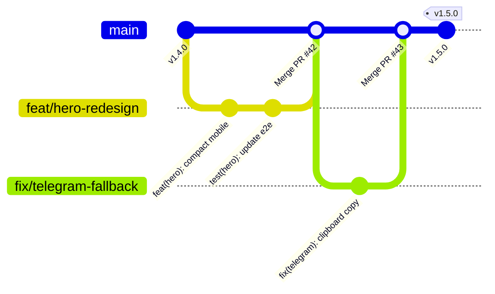

# Git Workflow Skill

Use this skill whenever creating branches, authoring commits, verifying quality gates prior to staging, resolving conflicts, tagging releases, or collaborating on the NetSeller repository.

---

## 1. Branching Model & Strategy

All work in NetSeller follows a structured, trunk-based branching model:



### Branch Naming Conventions
- **Feature Branches:** `feat/<short-kebab-name>` (e.g., `feat/friendly-hero-image`, `feat/khmer-package-pricing`)
- **Bug Fix Branches:** `fix/<defect-name>` (e.g., `fix/mobile-overflow-320px`, `fix/telegram-url-encoding`)
- **Performance & Polish:** `perf/<target-area>` or `style/<component>` (e.g., `perf/image-loading`, `style/clean-theme-colors`)
- **Maintenance & Docs:** `chore/<task>` or `docs/<topic>` (e.g., `chore/bump-deps`, `docs/git-workflow-skill`)

---

## 2. Mandatory Pre-Commit Quality Gates

Never stage or commit untested changes to the repository. Always execute this 5-step validation pipeline before staging:

```bash
# 1. Type verification (strict TypeScript 5.6)
pnpm tsc --noEmit

# 2. Linting (ESLint standard rules)
pnpm lint

# 3. Unit test suite (Vitest)
pnpm test

# 4. Production SSG build verification
pnpm build

# 5. Playwright cross-browser responsive tests (320px - 1440px)
pnpm test:e2e
```

> [!IMPORTANT]
> If any step in the pipeline fails, resolve the issue before proceeding. Never bypass checks using `--no-verify`.

---

## 3. Conventional Commit Standards

Every commit message must follow the [Conventional Commits](https://www.conventionalcommits.org/) specification:

$$\text{<type>}(\text{<scope>}): \text{<short, imperative description>}$$

### Types
- `feat`: A new user-facing capability, component, or package.
- `fix`: A bug fix or visual defect correction.
- `docs`: Documentation updates only (`CHANGELOG.md`, `README.md`, `.agent/`).
- `style`: Formatting, spacing, or CSS design token cleanup without logic changes.
- `refactor`: Code restructuring without adding features or fixing bugs.
- `perf`: Performance optimizations (e.g., image loading, bundle size).
- `test`: Adding or correcting tests (Vitest, Playwright).
- `chore`: Build tooling, dependency bumps, or `.gitignore` updates.

### Permitted Scopes
`hero` | `packages` | `promotions` | `contact` | `nav` | `footer` | `telegram` | `i18n` | `theme` | `config`

### Examples
- ✅ `feat(hero): replace technical telemetry card with friendly consultant image`
- ✅ `fix(mobile): eliminate oversized card padding and excessive whitespace on 320px`
- ✅ `style(theme): implement production-ready clean color tokens`
- ✅ `docs(changelog): document version 1.5.0 milestone`
- ❌ `update code` (too vague, missing type and scope)
- ❌ `fixed stuff on mobile` (non-conventional format)

---

## 4. Staging & Committing Protocol

1. **Review Changed Files:**
   ```bash
   git status
   git diff
   ```
2. **Stage Targeted Files Only:**
   ```bash
   # Stage only the files modified for the specific task
   git add src/components/home/HeroSection.tsx CHANGELOG.md
   ```
   *Do NOT use `git add .` indiscriminately to avoid staging unwanted logs, local configs, or OS metadata.*

3. **Commit with Conventional Message:**
   ```bash
   git commit -m "feat(hero): integrate friendly consultant portrait and floating status badges"
   ```

---

## 5. Release & Semantic Versioning Workflow

When releasing a new milestone:

1. **Verify All Quality Gates:** Run the complete validation chain.
2. **Update Documentation:** Add release entry in [`CHANGELOG.md`](../../CHANGELOG.md) under the new semantic version (e.g., `## [1.5.0] - YYYY-MM-DD`).
3. **Commit Release Preparation:**
   ```bash
   git add CHANGELOG.md
   git commit -m "chore(release): bump version to v1.5.0"
   ```
4. **Create Annotated Git Tag:**
   ```bash
   git tag -a v1.5.0 -m "Release v1.5.0: Clean theme design, friendly hero image, and mobile UX polish"
   ```
5. **Push Branch & Tags:**
   ```bash
   git push origin main --tags
   ```

---

## 6. Safe Synchronization & Rebasing

To keep feature branches updated with `main` without creating messy merge commits:

```bash
# 1. Fetch latest changes from remote
git fetch origin

# 2. Rebase feature branch on top of latest main
git rebase origin/main

# 3. If conflicts occur, resolve in editor, then:
git add <resolved-files>
git rebase --continue

# In case of emergency or unwanted conflict state:
git rebase --abort
```

> [!CAUTION]
> Never use `git push --force` on `main`. Only use `--force-with-lease` on isolated personal feature branches if a rebase was performed.

---

## 7. Stashing & Emergency Recovery

When you need to switch tasks quickly without committing incomplete work:

```bash
# Save working changes to stash with clear label
git stash save "WIP: hero responsive adjustments"

# List all active stashes
git stash list

# Re-apply stashed work
git stash pop
```

