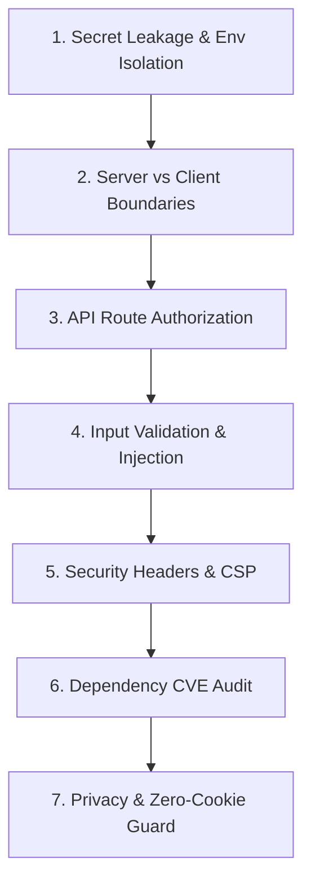

# Next.js Security Audit Skill

Use this skill when performing security reviews, pre-deployment security audits, evaluating third-party package risks, testing API route authorizations, or hardening Next.js App Router configurations.

---

## 1. Master Security Directives & Architecture

- **Primary Reference:** Read [`.agents/rules/07-security-performance.md`](../rules/07-security-performance.md) and [`ARCHITECTURE.md`](../../ARCHITECTURE.md).
- **Core Principle:** Strict server-client separation. Server components and route handlers hold private credentials; client components receive strictly public, sanitized data.
- **Privacy Standard:** Zero-cookie architecture. No third-party tracking cookies, no invasive ad pixels, and anonymous local-only analytics.

---

## 2. The 7-Pillar Next.js Security Audit Checklist



### Pillar 1: Secret Leakage & Environment Variable Isolation
- [ ] **Client Bundle Inspection:** Search for references to sensitive environment variables in `src/components/`, `src/app/[locale]/`, and client-side utilities.
  ```bash
  # Must return zero matches in client components
  grep -rn "TELEGRAM_BOT_TOKEN" src/components/ src/hooks/ 2>/dev/null || true
  grep -rn "ADMIN_PIN" src/components/ src/hooks/ 2>/dev/null || true
  ```
- [ ] **Prefix Enforcement:** Only environment variables explicitly prefixed with `NEXT_PUBLIC_` may be evaluated on the client.
- [ ] **Git & Repo Hygiene:** Confirm `.env`, `.env.local`, `.env.production` are ignored in `.gitignore`. Ensure `.env.example` contains only placeholder values.

### Pillar 2: Server vs. Client Boundary Verification
- [ ] **Client Component Minimization:** Confirm `"use client"` is placed only on leaves requiring browser events (`onClick`, `useState`, `useEffect`).
- [ ] **Server-Only Guards:** Critical server libraries (e.g., file system data services, Telegram notification dispatchers) must never be imported into client components.
- [ ] **No Node Built-ins on Client:** Ensure `fs`, `path`, or `crypto` are not bundled into client packages.

### Pillar 3: API Route Security & Authorization (`/api/*`)
- [ ] **Admin Authentication Guard:**
  - Route handlers modifying data (e.g., `POST /api/admin/data`) must verify the `x-admin-pin` header or payload PIN against `process.env.ADMIN_PIN`.
  - Ensure unauthorized requests return strict `401 Unauthorized` or `403 Forbidden` with no sensitive stack trace exposure.
- [ ] **HTTP Method Restriction:** Route files must only export explicit HTTP verbs (`GET`, `POST`). Reject unhandled verbs with `405 Method Not Allowed`.
- [ ] **Payload Size Safeguards:** Prevent denial-of-service via oversized JSON payloads. API handlers must validate request size or handle stream limits.

### Pillar 4: Input Validation & Injection Defense
- [ ] **Strict Zod Parsing:** All API endpoints must parse input through Zod schemas using `safeParse()`:
  - Phone numbers: Sanitized and validated against international / Cambodian formats.
  - Text fields: Trimmed and constrained by maximum length limits.
- [ ] **Zero Dangerous HTML:** Confirm zero unescaped usage of `dangerouslySetInnerHTML`. Where static SVG icons or markdown are rendered, ensure strict sanitization.
- [ ] **SQL / Command Injection:** Ensure all disk or database operations use parameterized methods or safe JSON serializers without string concatenation.

### Pillar 5: Security Headers & Next.js Configuration (`next.config.mjs`)
- [ ] **Header Hardening:** Verify `next.config.mjs` applies standard protective HTTP headers:
  ```javascript
  // Recommended headers in next.config.mjs
  {
    key: "X-Frame-Options",
    value: "DENY", // Clickjacking protection
  },
  {
    key: "X-Content-Type-Options",
    value: "nosniff", // MIME sniffing protection
  },
  {
    key: "Referrer-Policy",
    value: "strict-origin-when-cross-origin",
  },
  {
    key: "Permissions-Policy",
    value: "camera=(), microphone=(), geolocation=()",
  }
  ```
- [ ] **Powered-By Header:** Confirm `poweredByHeader: false` is configured to avoid leaking server runtime signatures.

### Pillar 6: Dependency CVE & Supply Chain Scanning
- [ ] **Vulnerability Audit:** Run package manager security audit:
  ```bash
  pnpm audit --prod
  ```
  Resolve any high or critical severity CVEs immediately.
- [ ] **Lockfile Integrity:** Confirm `pnpm-lock.yaml` is committed and clean with no mismatched hashes.

### Pillar 7: Privacy, Zero-Cookie & PII Protection
- [ ] **Zero Tracking Cookies:** Ensure no cookies are set without explicit user consent.
- [ ] **Privacy-Safe Analytics:** Confirm `PrivacyAnalytics` records only anonymous client counters in `localStorage` without sending PII or device fingerprints to external servers.
- [ ] **Telegram Deep Link Privacy:** Verify inquiries sent to Telegram do not expose customer passwords, tokens, or unnecessary internal metadata.

---

## 3. Automated Security Audit Runbook

Execute this command chain to perform a comprehensive security health check:

```bash
# 1. Check for sensitive secret exposure in codebase
grep -rn "TELEGRAM_BOT_TOKEN\|ADMIN_PIN" src/components/ src/hooks/ && echo "⚠️ Secrets in client code!" || echo "✅ No secrets in client components."

# 2. Dependency vulnerability audit
pnpm audit --audit-level=high

# 3. Strict TypeScript type check (catches missing boundary validations)
pnpm tsc --noEmit

# 4. ESLint security and boundary check
pnpm lint

# 5. Execute full unit test and E2E security assertions
pnpm test && pnpm test:e2e
```

---

## 4. Remediation & Incident Response Guide

1. **Exposed Token / Secret:**
   - Invalidate the token immediately in the provider console (e.g., Telegram BotFather).
   - Rotate the secret in `.env.local` / production environment variables.
   - If committed to Git, rewrite history or force rotate the secret immediately.
2. **Vulnerable Dependency:**
   - Run `pnpm update <package> --latest`.
   - If a direct update is not feasible, use `pnpm.overrides` in `package.json` to enforce safe sub-dependency versions.
3. **API Route Bypass:**
   - Ensure `DataService` and API route handlers require PIN authentication and validate schemas with `schema.safeParse()`.

