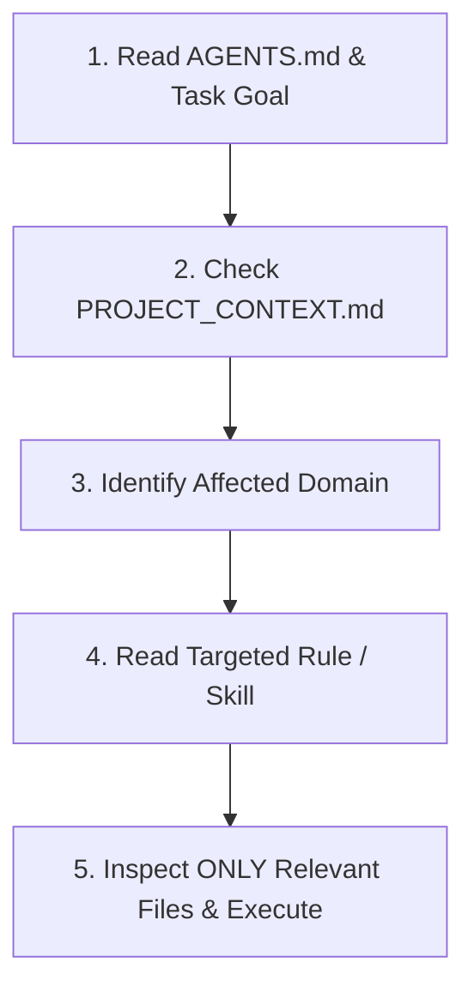

# NetSeller AI Agent Instructions & Operating Manual

> **CRITICAL DIRECTIVE FOR ALL AI AGENTS:**  
> **Before starting any new task, read this file (`AGENTS.md`) and the relevant sections of [`PROJECT_CONTEXT.md`](./PROJECT_CONTEXT.md) and [`ARCHITECTURE.md`](./ARCHITECTURE.md). DO NOT reanalyze or scan the entire repository unless the user explicitly requests a full audit or the task materially changes system architecture. Use the persistent documentation and investigate only the files relevant to the specific task.**

---

## 1. Project Identity & Business Purpose

- **Project Name:** NetSeller
- **Nature of Business:** Personal Internet & Fiber Optic Sales Consultant Platform (Cambodia).
- **Core Mission:** Convert Cambodian residential, home office, and business customers into qualified Internet subscription leads handled directly through the consultant's personal Telegram account.
- **Key Customer Journey:**
  $$\text{Physical Business Card (QR Code)} \longrightarrow \text{Mobile Landing Page} \longrightarrow \text{Browse/Compare Packages} \longrightarrow \text{Inquiry Form} \longrightarrow \text{1-Tap Telegram Order}$$
- **Scope Boundary:** NetSeller is **NOT** an ISP corporate portal, an e-commerce platform with automated payments, or a multi-tenant SaaS. It is an ultra-fast, high-converting personal sales front-end.

---

## 2. Technology Stack & Runtime

- **Framework:** Next.js 14 (App Router)
- **Language:** TypeScript 5.6 (strict mode)
- **Styling:** Tailwind CSS 3.4 with CSS variables design tokens
- **Component UI:** Radix UI primitives (`@radix-ui/react-*`), Lucide React icons, Tailwind CSS Animate
- **Forms & Validation:** React Hook Form + Zod (localized validation schema)
- **Internationalization:** `next-intl` (English: `en`, Khmer: `km`)
- **QR & Utilities:** `qrcode` (high error correction SVG/PNG generator)
- **Testing:** Vitest (unit tests) + Playwright (cross-browser responsive E2E)
- **Package Manager:** `pnpm`

---

## 3. Persistent Project Knowledge System

To prevent repetitive repository analysis, all agents must consult this documentation hierarchy:

| Document | Primary Content & Purpose | When to Consult |
|:---|:---|:---|
| [`AGENTS.md`](./AGENTS.md) | Agent operating rules, directory map, task initialization protocol | Start of every session |
| [`PROJECT_CONTEXT.md`](./PROJECT_CONTEXT.md) | Ground-truth facts, routes, components, packages, env vars, config | Feature, bug, or config tasks |
| [`ARCHITECTURE.md`](./ARCHITECTURE.md) | Server vs Client boundaries, i18n routing, Telegram service, state | Architectural or data-flow changes |
| [`DEVELOPMENT_GUIDE.md`](./DEVELOPMENT_GUIDE.md) | CLI commands, testing scripts, how to add pages/packages/i18n | Implementation & testing |
| [`CHANGELOG.md`](./CHANGELOG.md) | Architectural milestones, schema updates, breaking changes | Prior changes & history |
| [`.agents/rules/`](./.agents/rules/) | Focused modular rules (Context, Coding, Next.js, UI, i18n, Tests, Security) | Domain-specific deep dives |
| [`.agents/skills/`](./.agents/skills/) | On-demand procedural playbooks (Next.js, UI Review, Localization, Production) | Complex multi-step tasks |
| [`.agents/workflows/`](./.agents/workflows/) | Standardized operational workflows (feature, bug, ui, review, test) | Standardized task cycles |

---

## 4. Mandatory Task Initialization Protocol

When receiving a user prompt, follow this 5-step sequence:

1. **Classify the task category:** (e.g., UI enhancement, Khmer translation, package update, Telegram message formatting, bug fix).
2. **Consult targeted documentation:**
   - UI / Layout $\rightarrow$ Read [`.agents/rules/04-ui-ux-design.md`](./.agents/rules/04-ui-ux-design.md) & [`.agents/skills/ui-ux-review/SKILL.md`](./.agents/skills/ui-ux-review/SKILL.md).
   - Localization $\rightarrow$ Read [`.agents/rules/05-localization-km-en.md`](./.agents/rules/05-localization-km-en.md) & [`.agents/skills/localization/SKILL.md`](./.agents/skills/localization/SKILL.md).
   - Architecture $\rightarrow$ Read [`.agents/rules/03-nextjs-architecture.md`](./.agents/rules/03-nextjs-architecture.md) & [`ARCHITECTURE.md`](./ARCHITECTURE.md).
   - Bug fix / Test $\rightarrow$ Read [`.agents/rules/06-testing-quality.md`](./.agents/rules/06-testing-quality.md) & [`.agents/workflows/fix-bug.md`](./.agents/workflows/fix-bug.md).
3. **Inspect ONLY target files:** Do not run `find` or `ls` across the entire codebase. Jump straight to the known path (e.g., `src/components/packages/PackageCard.tsx` or `messages/km.json`).
4. **Implement changes in minimal scope:** Preserve existing naming, imports, and design tokens.
5. **Verify and test:** Run `pnpm test`, `pnpm tsc --noEmit`, or `pnpm lint` before declaring completion.

---

## 5. Core Engineering Principles

### A. Next.js App Router & Boundaries
- Server Components by default. Use `"use client"` only for components requiring hooks (`useState`, `useEffect`), interactive handlers (`onClick`), or browser APIs.
- Keep Client Components low in the component tree to optimize server rendering and streaming.

### B. Localization (Khmer & English)
- **Zero hardcoded text:** Every user-visible string must reside in `messages/en.json` and `messages/km.json`.
- **Natural Khmer phrasing:** Use culturally natural Cambodian telecom terms (e.g., "ខ្សែកាបអុបទិក" for fiber, "ដំឡើងឥតគិតថ្លៃ" for free setup). Avoid machine-like literal phrasing.
- **Line heights:** Always maintain generous line height (`leading-relaxed`) on elements rendering Khmer text to prevent vowel subscript clipping.

### C. Telegram Deep Linking & Fallbacks
- Telegram URLs are generated via `TelegramService` (`src/features/telegram/telegram.service.ts`).
- Always support both primary deep linking (`https://t.me/<username>`) and the 1-click clipboard copy fallback for devices without registered Telegram URL schemes.
- **Never expose private bot tokens** in client-side bundles or repository config files.

### D. Responsive Guarantee (320px – 2560px)
- The application is mobile-first.
- Absolutely zero horizontal scrolling (`overflow-x: clip` on `html`/`body`).
- Touch targets must be at least 44px $\times$ 44px on mobile devices.

---

## 6. Documentation Maintenance Policy

When an implementation task alters any of the following, the agent is required to update the relevant documentation file:
- **New or modified routes:** Update [`PROJECT_CONTEXT.md`](./PROJECT_CONTEXT.md) and [`ARCHITECTURE.md`](./ARCHITECTURE.md).
- **New packages, data models, or config fields:** Update [`PROJECT_CONTEXT.md`](./PROJECT_CONTEXT.md).
- **New scripts or build tools:** Update [`DEVELOPMENT_GUIDE.md`](./DEVELOPMENT_GUIDE.md).
- **Significant architectural changes or releases:** Record an entry in [`CHANGELOG.md`](./CHANGELOG.md).

*Do NOT rewrite or bloat documentation after minor cosmetic edits.*

