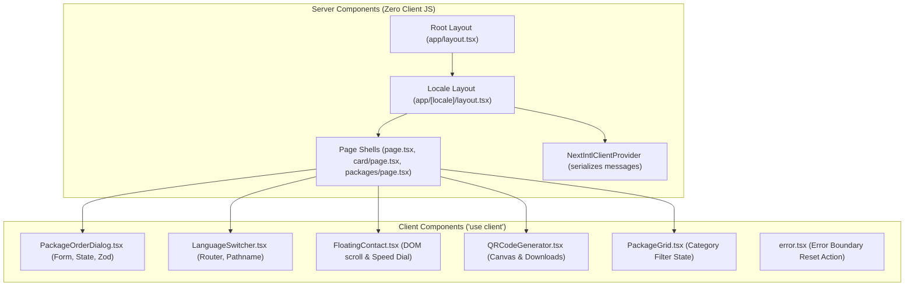
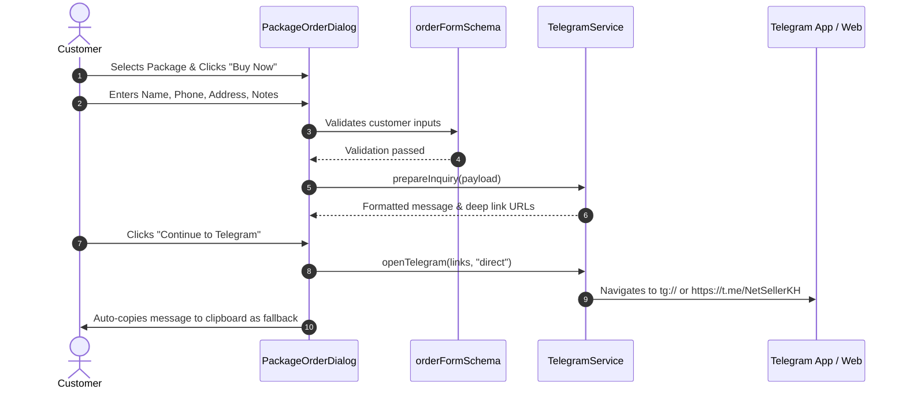

# NetSeller System Architecture Blueprint

**Document:** `ARCHITECTURE.md`  
**Framework:** Next.js 14 App Router  
**Last Updated:** October 31, 2026  

---

## 1. Directory Tree & Architecture Overview

```text
NetSeller/
├── messages/                        # next-intl translation dictionaries
│   ├── en.json                      # English messages
│   └── km.json                      # Khmer messages
├── public/                          # Static assets (favicons, manifest, og-image)
├── src/
│   ├── middleware.ts                # Locale routing & sub-path redirection
│   ├── app/
│   │   ├── layout.tsx               # Root HTML layout with viewport & font loading
│   │   ├── page.tsx                 # Root redirection to default locale
│   │   ├── globals.css              # Tailwind base, CSS variables, typography rules
│   │   ├── robots.ts                # SEO crawler rules
│   │   ├── sitemap.ts               # Multilingual XML sitemap
│   │   ├── [locale]/
│   │   │   ├── layout.tsx           # Locale provider, header, footer, mobile nav
│   │   │   ├── page.tsx             # Homepage composition
│   │   │   ├── loading.tsx          # Pulse skeleton fallback
│   │   │   ├── not-found.tsx        # Bilingual 404 boundary
│   │   │   ├── error.tsx            # Client error boundary
│   │   │   ├── card/page.tsx        # Digital Business Card (/card)
│   │   │   ├── contact/page.tsx     # Direct Contact & Inquiries (/contact)
│   │   │   ├── packages/page.tsx    # Full Catalog & Compare (/packages)
│   │   │   └── qr/page.tsx          # QR Code Generator Suite (/qr)
│   │   └── api/
│   │       ├── inquiries/route.ts   # Inquiry validation & optional webhook
│   │       └── vcard/route.ts       # vCard .vcf binary download stream
│   ├── components/
│   │   ├── home/                    # Homepage section components
│   │   ├── layout/                  # Navigation, Header, Footer, LanguageSwitcher
│   │   ├── packages/                # Card, Grid, OrderDialog, ComparisonTable
│   │   ├── qr/                      # Interactive QRCodeGenerator component
│   │   └── ui/                      # Reusable Radix/Tailwind design tokens
│   ├── config/                      # sellerConfig, siteConfig, navigationConfig
│   ├── data/                        # packages.ts, promotions.ts, testimonials.ts
│   ├── features/                    # Domain logic (telegram, qr, vcard)
│   ├── i18n/                        # routing.ts, request.ts (next-intl config)
│   ├── lib/                         # analytics.ts, utils.ts, validations/
│   └── types/                       # TypeScript interfaces & types
└── tests/
    ├── setup.ts                     # Vitest environment setup
    ├── unit/                        # 7 Vitest test suites (22 tests)
    └── e2e/                         # 2 Playwright specs (44 assertions)
```

---

## 2. Next.js App Router & Boundary Architecture

### Server vs. Client Component Separation

To minimize JavaScript bundle size and maximize performance, NetSeller adheres strictly to the Server Component first paradigm:



### Server Components:
- **`src/app/[locale]/layout.tsx`**: Injects `NextIntlClientProvider`, metadata generation, and wraps layout chrome.
- **`src/app/[locale]/page.tsx`**: Composes sections without client overhead.
- **`src/app/[locale]/card/page.tsx`**: Prerenders metadata and structured profile data for fast mobile loading.

### Client Components:
- Marked with `"use client"` at the top of the file.
- Used strictly where user interaction, DOM manipulation, or state is required:
  - `src/components/packages/PackageOrderDialog.tsx` (modals, forms)
  - `src/components/packages/PackageGrid.tsx` (category tab filter)
  - `src/components/layout/LanguageSwitcher.tsx` (locale route switching)
  - `src/components/layout/FloatingContact.tsx` (speed-dial FAB)
  - `src/components/qr/QRCodeGenerator.tsx` (canvas rendering & download triggers)

---

## 3. Localization Architecture (`next-intl`)

1. **Routing Definition (`src/i18n/routing.ts`):**
   ```typescript
   export const routing = defineRouting({
     locales: ["en", "km"],
     defaultLocale: "en",
     localePrefix: "always",
   });
   ```
2. **Request Handler (`src/i18n/request.ts`):**
   Dynamically resolves messages from `messages/${locale}.json` per request.
3. **Middleware (`src/middleware.ts`):**
   Intercepts incoming paths, redirects `/` to the preferred or default locale (`/en` or `/km`), and handles locale prefixing.
4. **Client Translation Injection:**
   `NextIntlClientProvider` in `src/app/[locale]/layout.tsx` provides dictionary access to Client Components via `useTranslations()`.

---

## 4. Telegram Sales Flow Architecture

The conversion funnel operates through a dedicated domain feature in `src/features/telegram/`:



### URL Protocols Generated:
1. **Direct Chat URL:** `https://t.me/<username>` (Primary mobile/desktop URL)
2. **App Protocol:** `tg://resolve?domain=<username>` (Native Telegram app hook)
3. **Prepared Share URL:** `https://t.me/share/url?url=<encoded_message>`
4. **Clipboard Copy:** Automatic copy to clipboard ensures customers on Web Telegram can simply press `Ctrl+V` / `Cmd+V`.

---

## 5. QR Code Generation Architecture

Located in `src/features/qr/qr.service.ts`:
- **Engine:** `qrcode` npm library.
- **Error Correction:** Level `H` (High: ~30% damage recovery) to guarantee physical readability even when business cards are scuffed, creased, or partially occluded.
- **Quiet Zone:** 4-module quiet zone compliant with ISO/IEC 18004.
- **Output Formats:**
  - `generateSvg()`: Clean vector XML for high-resolution offset printing.
  - `generatePngDataUrl()`: 1024px high-resolution raster for quick digital sharing.

---

## 6. Shared UI System & Styling Architecture

- **Tailwind Tokens:** Defined in `src/app/globals.css` using HSL CSS variables:
  - `--primary`: `221.2 83.2% 53.3%` (`#2563EB`)
  - `--secondary`: `198.6 88.7% 48.4%` (`#0EA5E9`)
  - `--background`: `210 40% 98%` (`#F8FAFC`)
  - `--border`: `214.3 31.8% 91.4%` (`#E2E8F0`)
- **Typography Support:**
  - `Inter`: Loaded for Latin characters (`en`).
  - `Noto Sans Khmer`: Applied to Khmer strings (`km`) with line-height safeguards (`leading-relaxed`) preventing subscript vowel collision.
- **Responsive Navigation Architecture:**
  - $\ge 768\text{px}$: Sticky header with desktop navigation links.
  - $< 768\text{px}$: Mobile bottom dock (`MobileNavigation.tsx`) with 48px touch targets, plus floating speed dial (`FloatingContact.tsx`) offset above the dock.

